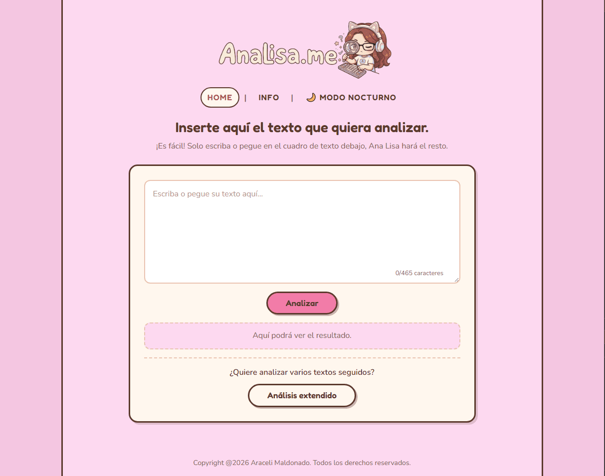
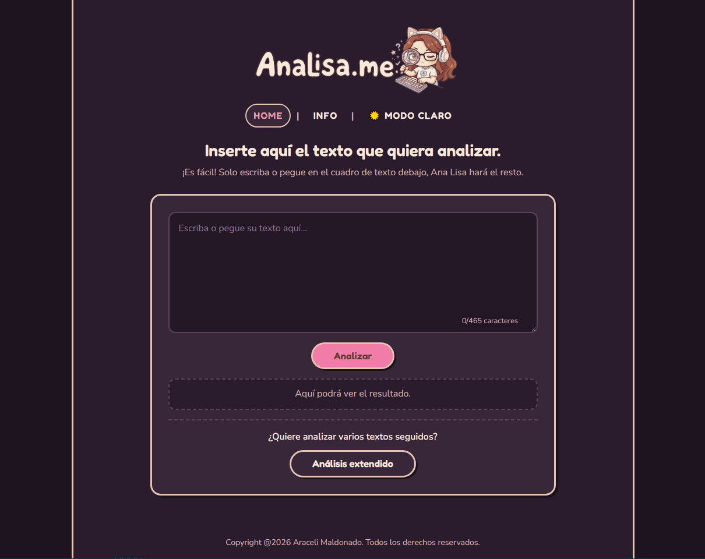
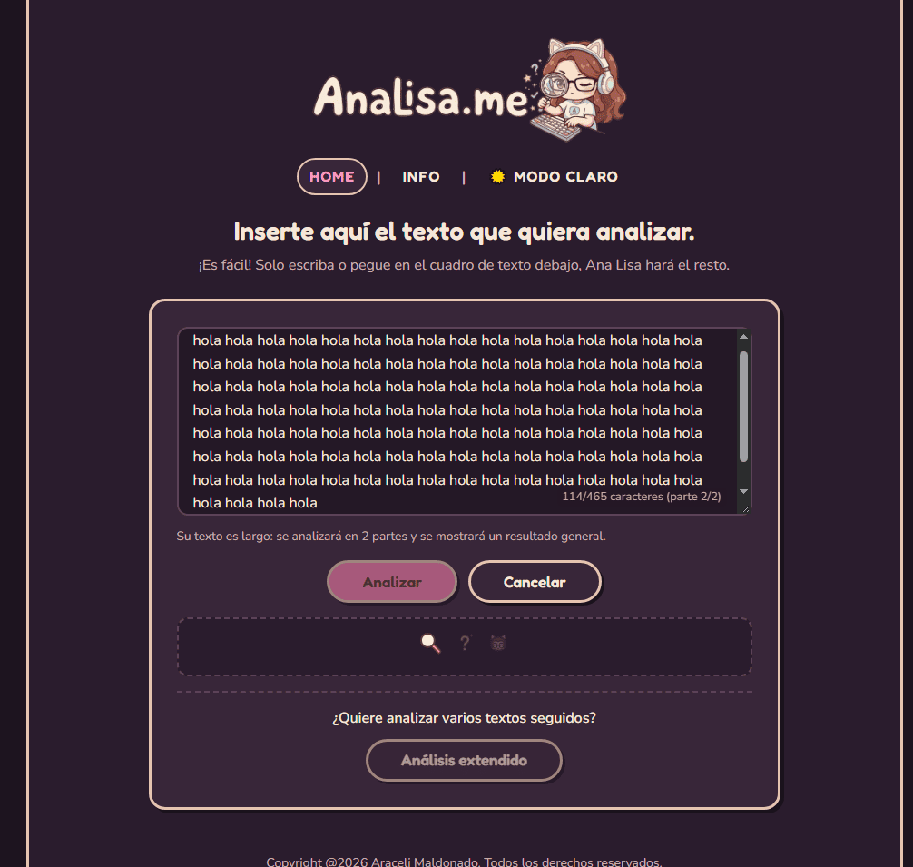
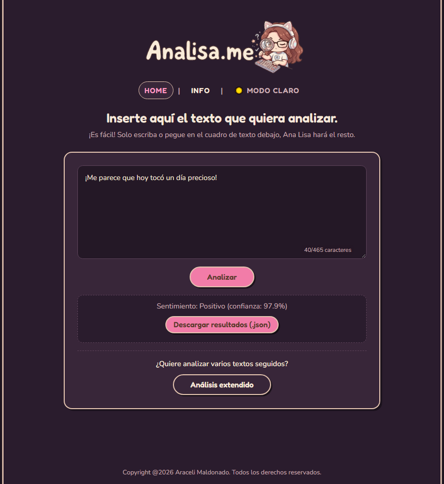
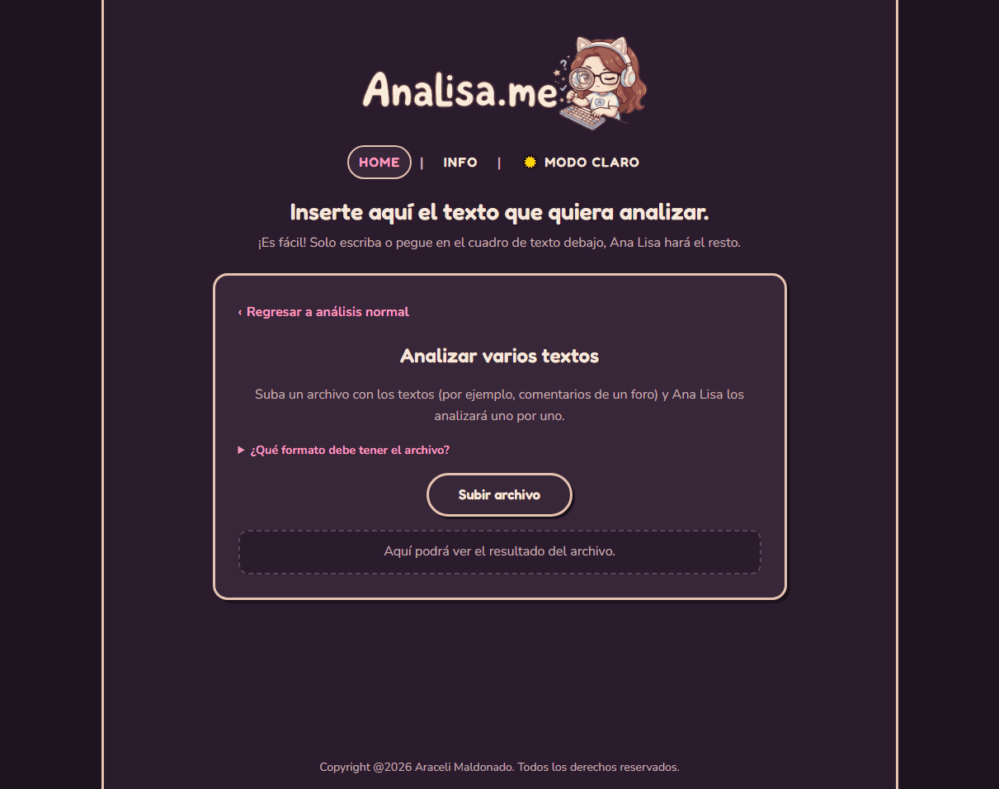
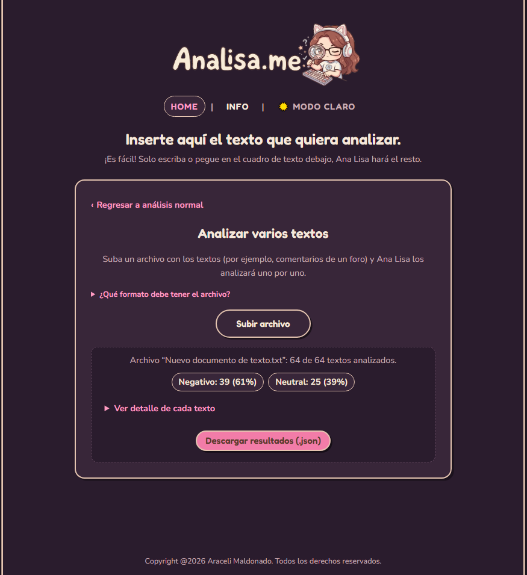

# AnaLisaMe: análisis de sentimiento en español

**AnaLisaMe** es una aplicación web full-stack que clasifica textos en español como **positivos, negativos o neutrales**, junto con un porcentaje de confianza. Usa un modelo de lenguaje preentrenado (RoBERTuito) servido por una API en FastAPI, con una interfaz en React.

## 📸 Demostración

<p align="center">
  
  
</p>

<p align="center">
  
  
</p>

<p align="center">
  
  
</p>

## ✨ Características

* 🔍 **Análisis de sentimiento** de textos en español con un modelo RoBERTa (Hugging Face Transformers).
* ⚡ **Dos modos de análisis:**
  * **Normal:** escribes o pegas un texto y obtienes su sentimiento.
  * **Extendido:** subes un archivo `.json` o `.txt` con varios textos (por ejemplo, comentarios de un foro) y obtienes un resumen por sentimiento y el detalle de cada texto.
* ✂️ **Textos largos:** los textos de más de 465 caracteres se dividen en partes, se analiza cada una y se muestra un resultado general. Funciona tanto en el modo normal como en el extendido.
* 📦 **Envío por tandas:** en el modo extendido, las partes se envían a la API en grupos de hasta 64, de modo que un archivo grande no supera el límite de la API.
* ⬇️ **Descarga de resultados:** en ambos modos puedes descargar el análisis en un archivo `.json` (ver [Descargar resultados](#descargar-resultados)).
* 🛡️ **Validación de entradas:** se rechazan los textos sin palabras (solo símbolos o números), tanto en el frontend como en la API. En el modo extendido, un texto inválido se marca con su error y no detiene el análisis de los demás.
* 💬 **Mensajes de error claros:** la aplicación avisa si el servidor no responde o está apagado, si tardó demasiado, si se superó el límite de peticiones o si rechazó los datos enviados.
* 🌓 **Modo claro y modo nocturno.**
* 💻 **Funciona en CPU:** no requiere una GPU. Si tienes una GPU NVIDIA compatible, puedes instalar PyTorch con soporte CUDA para acelerar el análisis (ver más abajo).

## 🛠️ Tecnologías utilizadas

* **Backend:** Python, FastAPI, Uvicorn
* **IA:** PyTorch (CPU o GPU), Hugging Face Transformers
* **Frontend:** React + Vite, Axios
* **Modelo:** [pysentimiento/robertuito-sentiment-analysis](https://huggingface.co/pysentimiento/robertuito-sentiment-analysis) (modelo para análisis de sentimiento en español)

## 📋 Requisitos previos

* [Git](https://git-scm.com/)
* [Python](https://www.python.org/) 3.10 o superior (probado con 3.12)
* [Node.js](https://nodejs.org/) (versión LTS reciente) y npm
* Conexión a internet en la primera ejecución: el modelo (unos 400-500 MB) se descarga de Hugging Face y queda guardado en la caché local.

## 🚀 Instalación y configuración local

### 1. Clonar el repositorio

```bash
git clone https://github.com/tu-usuario/analisis-sentimiento.git
cd analisis-sentimiento
```

### 2. Configurar el backend

Entra a la carpeta del backend y crea un entorno virtual:

```bash
cd backend
python3 -m venv venv
```

> En Windows usa `python` en lugar de `python3`. En Ubuntu/WSL, si falla la creación del entorno, instala antes `python3-venv` con `sudo apt install python3-venv`.

Activa el entorno virtual:

* Linux / macOS / WSL:

  ```bash
  source venv/bin/activate
  ```

* Windows (PowerShell):

  ```powershell
  .\venv\Scripts\Activate.ps1
  ```

  Si PowerShell indica que la ejecución de scripts está deshabilitada, ejecuta primero `Set-ExecutionPolicy -Scope Process -ExecutionPolicy Bypass` y vuelve a activar el entorno.

#### Instalar PyTorch (elige **una** opción)

PyTorch se instala **antes** que el resto de las dependencias y por separado, porque existen versiones distintas según tu hardware. La versión con soporte para GPU pesa varios GB; la de CPU es mucho más liviana.

**Opción A: solo CPU** *(recomendada si no tienes una GPU NVIDIA, si es antigua o con poca memoria, o si prefieres una instalación liviana)*

```bash
pip install torch --index-url https://download.pytorch.org/whl/cpu
```

Para el uso normal de esta aplicación, la CPU suele alcanzar.

**Opción B: GPU NVIDIA (CUDA)**

1. Entra a [pytorch.org/get-started/locally](https://pytorch.org/get-started/locally/).
2. Elige *Stable*, tu sistema operativo, *Pip*, *Python* y la versión de CUDA que sea compatible con tu tarjeta.
3. Copia y ejecuta el comando que te muestra la página. Tiene esta forma (el número `XXX` depende de la versión de CUDA que elijas):

   ```bash
   pip install torch --index-url https://download.pytorch.org/whl/cuXXX
   ```

> Las versiones de CUDA que ofrece PyTorch cambian con el tiempo, y no todas las tarjetas antiguas son compatibles con las más nuevas. Por eso es mejor generar el comando desde la página oficial.

Para comprobar qué versión quedó instalada:

```bash
python -c "import torch; print(torch.__version__, torch.cuda.is_available())"
```

Si aparece `True` al final, PyTorch detecta tu GPU; con `False`, usará la CPU. La aplicación usa la GPU automáticamente cuando está disponible.

#### Instalar el resto de las dependencias

```bash
pip install -r requirements.txt
```

#### Iniciar el servidor

```bash
uvicorn main:app --reload
```

La API queda disponible en `http://localhost:8000`, y su documentación interactiva en `http://localhost:8000/docs`. En la primera ejecución se descarga el modelo, por lo que el arranque puede tardar.

### 3. Configurar el frontend

En otra terminal, desde la raíz del proyecto:

```bash
cd frontend
npm install
npm run dev
```

Abre `http://localhost:5173` en tu navegador.

> El frontend se comunica con la API en `http://localhost:8000` (configurado en `frontend/services/sentiment.service.js`), y la API acepta peticiones desde `http://localhost:5173`. Si cambias algún puerto, actualiza ambos lugares.

## 🧭 Uso

* **Análisis normal:** escribe o pega un texto y presiona **Analizar**.
* **Análisis extendido:** presiona **Análisis extendido**, elige un archivo y obtén el resumen y el detalle de cada texto. Formatos aceptados:

  * `.json`: un objeto con una lista llamada `"textos"`, o directamente una lista, ya sea de textos o de objetos con un campo `texto` (y, opcionalmente, `id`). También se aceptan los nombres de campo `text`, `comentario`, `comment`, `mensaje` y `contenido`.

    ```json
    {
      "textos": [
        "Me encantó el producto",
        "Llegó roto y nadie responde"
      ]
    }
    ```

    ```json
    [
      { "id": 1, "texto": "Me encantó el producto" },
      { "id": 2, "texto": "Llegó roto y nadie responde" }
    ]
    ```

  * `.txt`: un texto por línea.

### Descargar resultados

Después de un análisis aparece el botón **Descargar resultados (.json)**, tanto en el modo normal como en el extendido. El archivo es una lista con un objeto por texto:

```json
[
  {
    "comentario": "hola",
    "sentimiento": "neutral",
    "confianza": "96%"
  }
]
```

* En el **modo normal** se descarga `resultado_sentimiento.json` con un solo elemento. Si el texto era largo y se dividió en partes, contiene el resultado general, no el detalle por parte.
* En el **modo extendido** se descarga `<nombre del archivo>_resultados.json`, con un elemento por texto y en el mismo orden que el archivo subido.
* Si un texto no se pudo analizar, en lugar de `sentimiento` y `confianza` el elemento trae un campo `error` con el motivo.
* La confianza se redondea a un número entero.

### Límites

| Qué | Límite |
| --- | --- |
| Caracteres por parte | 465 (los textos más largos se dividen automáticamente) |
| Partes por texto | 20 |
| Textos por archivo | 100 |
| Tamaño del archivo | 1 MB |
| Textos por petición a la API | 64 (el frontend envía los archivos grandes por tandas) |
| Peticiones por minuto | Limitadas por IP en `backend/main.py` (por defecto, 30 por minuto) |

## 🔌 API

`POST /api/sentiment/batch`

```json
{ "textos": ["Me encantó", "Muy malo"] }
```

Respuesta (en el mismo orden que la entrada; los textos sin palabras analizables devuelven un campo `error` en lugar de `etiqueta` y `confianza`):

```json
{
  "resultados": [
    { "texto": "Me encantó", "etiqueta": "Positivo", "confianza": 0.97 },
    { "texto": "Muy malo", "etiqueta": "Negativo", "confianza": 0.91 }
  ]
}
```

La API acepta hasta 64 textos por petición, de hasta 500 caracteres cada uno. Si se supera alguno de esos límites responde `422`, y si se superan las peticiones por minuto, `429`.

> Si cambias el máximo de textos por petición en `backend/main.py` (`max_length` de `textos`), actualiza también `MAX_POR_PETICION` en `frontend/src/utils/lote.js`: deben coincidir.

## 📊 Evaluación del modelo

Para medir qué tan bien clasifica el modelo se armó un conjunto de evaluación y un script que compara el resultado esperado con el obtenido por la aplicación. Todo está en la carpeta `dataset/`.

### Conjunto de evaluación

Son **100 comentarios** con su etiqueta esperada:

* **78 reseñas reales** de películas, tomadas del conjunto [IMDB Dataset of 50K Movie Reviews (Spanish)](https://www.kaggle.com/datasets/luisdiegofv97/imdb-dataset-of-50k-movie-reviews-spanish) de Kaggle (reseñas de IMDB traducidas al español): 39 positivas y 39 negativas, de hasta 465 caracteres, elegidas al azar con una semilla fija para que la muestra sea reproducible.
* **22 reseñas neutras inventadas**, ya que ese conjunto solo tiene reseñas positivas y negativas. Son breves y mezclan reseñas descriptivas con reseñas equilibradas.

Archivos:

* `reviews_test.json`: los 100 comentarios con su etiqueta esperada (`review_es`, `sentimiento`).
* `reviews_app.json`: los mismos textos en el formato que acepta la aplicación (`{"textos": [...]}`).

Para volver a descargar el conjunto de Kaggle y regenerar la muestra hace falta instalar `kagglehub` (`pip install kagglehub`). No es necesario para usar la aplicación.

### Cómo repetir la evaluación

1. Inicia el backend y el frontend (ver [Instalación](#-instalación-y-configuración-local)).
2. En la aplicación, entra a **Análisis extendido** y sube `reviews_app.json`.
3. Presiona **Descargar resultados (.json)**. Obtendrás `reviews_app_resultados.json`.
4. Desde la carpeta `dataset/`, con el entorno virtual activado, ejecuta:

   ```bash
   python comparar_resultados.py reviews_app_resultados.json --esperado reviews_test.json
   ```

El script solo usa la librería estándar de Python. Empareja los textos por contenido (el orden de los archivos no importa), muestra la comparación por consola y genera dos archivos CSV:

* `reviews_app_comparacion.csv`: una fila por comentario, con el resultado esperado, el obtenido, la confianza y si acertó.
* `reviews_app_metricas.csv`: accuracy, precisión, recall y F1 por clase, y la matriz de confusión.

Opciones útiles: `--sep ","` (por defecto el separador es `;`, que abre bien en Excel en español), `--largo 0` (incluye el texto completo de cada comentario) y `-o nombre.csv` (nombre del archivo de salida). Los textos que la aplicación devolvió con error no cuentan en las métricas, pero quedan registrados en el CSV.

### Resultados

Con el modelo [robertuito-sentiment-analysis](https://huggingface.co/pysentimiento/robertuito-sentiment-analysis) sobre los 100 comentarios:

| Métrica | Valor |
| --- | --- |
| Accuracy | 78,0 % (78 de 100) |
| F1 macro | 76,7 % |

| Clase | Precisión | Recall | F1 | Cantidad |
| --- | --- | --- | --- | --- |
| Positivo | 78,0 % | 82,1 % | 80,0 % | 39 |
| Negativo | 78,0 % | 82,1 % | 80,0 % | 39 |
| Neutral | 77,8 % | 63,6 % | 70,0 % | 22 |

Matriz de confusión (filas = esperado, columnas = obtenido):

| | Positivo | Negativo | Neutral |
| --- | --- | --- | --- |
| **Positivo** | 32 | 6 | 1 |
| **Negativo** | 4 | 32 | 3 |
| **Neutral** | 5 | 3 | 14 |

La clase neutral es la que más se confunde: 8 de los 22 comentarios neutrales se clasificaron como positivos o negativos.

> Estos números son una **evaluación a pequeña escala** y deben interpretarse con cautela: con 100 comentarios el margen de error de la accuracy es de varios puntos porcentuales, y con solo 22 neutrales es aún mayor para esa clase. Además, las reseñas de IMDB están traducidas automáticamente y son más largas que los mensajes con los que se entrenó el modelo, y las neutrales fueron escritas para este proyecto, por lo que no representan textos reales.

## ⚠️ Limitaciones

* El modelo se entrenó principalmente con mensajes cortos y coloquiales, así que rinde mejor con ese tipo de texto.
* No siempre detecta el sarcasmo ni la ironía.
* Los resultados son estimaciones, no verdades absolutas. Una confianza baja indica que el modelo no está seguro.
* Solo funciona con textos en español.
* La evaluación se hizo con un conjunto pequeño y parcialmente artificial (ver [Evaluación del modelo](#-evaluación-del-modelo)), por lo que sus resultados no son comparables directamente con los publicados para este modelo.

## 📁 Estructura del proyecto

```
analisis-sentimiento/
├── backend/
│   ├── main.py            # API (FastAPI)
│   ├── inference.py       # carga del modelo y análisis por lotes
│   └── requirements.txt
├── frontend/
│   ├── services/
│   │   └── sentiment.service.js   # llamadas a la API (Axios)
│   └── src/
│       ├── pages/
│       │   └── Home.jsx           # pantalla principal (modo normal y extendido)
│       ├── components/
│       │   └── Resultados.jsx     # resultados, animación de carga y botón de descarga
│       └── utils/
│           ├── texto.js           # límites, validación, división de textos largos y lectura de archivos
│           ├── lote.js            # análisis de archivos: partes, tandas y errores del servidor
│           └── descarga.js        # descarga de resultados en JSON
└── dataset/
    ├── comparacion/
    │   ├── comparacion_sets.py    # compara resultado esperado vs obtenido (CSV y consola)
    │   └── reviews_app.json       # los mismos textos en el formato de la aplicación
    └── dataset.py                 # descarga el data set de imdb en español y mezcla con reviews custom neutras
```

## 🙏 Créditos

* Modelo: [pysentimiento/robertuito-sentiment-analysis](https://huggingface.co/pysentimiento/robertuito-sentiment-analysis), del proyecto [pysentimiento](https://github.com/pysentimiento/pysentimiento). Revisa las condiciones de uso del modelo en su página.
* Conjunto de evaluación: [IMDB Dataset of 50K Movie Reviews (Spanish)](https://www.kaggle.com/datasets/luisdiegofv97/imdb-dataset-of-50k-movie-reviews-spanish), en Kaggle. Revisa sus condiciones de uso en esa página.
* [Hugging Face Transformers](https://huggingface.co/docs/transformers) y [PyTorch](https://pytorch.org/).

---

© 2026 Araceli Maldonado. Todos los derechos reservados.